<picture>
  <source media="(prefers-color-scheme: dark)" srcset="./assets/aster-dark.svg">
  <source media="(prefers-color-scheme: light)" srcset="./assets/aster-light.svg">
  
</picture>

# 弋炎_Aster

做 AI 应用、桌面工具和 Android 扩展，也长期维护青弋 Bot。最近在探索虚拟角色、语音交互与混合现实的结合。

[Blog ↗](https://xiaoku2300.github.io/) · [青弋 Bot ↗](https://sakuya.asia/) · [All repositories ↗](https://github.com/XIAOKU2300?tab=repositories)

## Selected work

<table>
  <tr>
    <td width="50%" valign="top">
      01 / DESKTOP · AI
      <h3><a href="https://github.com/XIAOKU2300/WineFoxDesktop">WineFox Desktop ↗</a></h3>
      
连接 ComfyUI 的 Windows 图像生成工作台。

      
文生图 / 图生图、LoRA 与工作流管理、任务历史与多人房间；自动更新带签名校验。

      Python · Rust · Tauri · ComfyUI
    </td>
    <td width="50%" valign="top">
      02 / ANDROID · MUSIC
      <h3><a href="https://github.com/XIAOKU2300/Synoc-Music">Synoc Music ↗</a></h3>
      
基于 <a href="https://github.com/lladlam/MeloX-Android">MeloX Android</a> 扩展的音乐客户端。

      
为山灵播放器接入 SyncLink Wi-Fi / 蓝牙控制、设备曲库与 Android 媒体会话。

      Kotlin · Jetpack Compose · Media3
    </td>
  </tr>
  <tr>
    <td width="50%" valign="top">
      03 / BOT · SELF-HOSTED
      <h3><a href="https://sakuya.asia/">青弋 Bot ↗</a></h3>
      
持续维护的 QQ 机器人，提供游戏数据查询、角色面板与图像渲染。

      
围绕 TRSS-Yunzai / AstrBot 做插件集成、服务部署与日常维护。

      Python · JavaScript · Redis · Linux
    </td>
    <td width="50%" valign="top">
      04 / GAME · NUMERICAL TOOLS
      <h3>EchoMatrix</h3>
      
《鸣潮》声骸与面板评分、伤害模拟和技能时间轴工具。

      
评分服务已落地，角色权重与技能规则持续校验。相关公开组件：<a href="https://github.com/XIAOKU2300/UICoreForEcho">UICoreForEcho</a>。

      Python · FastAPI · Web / 开发中
    </td>
  </tr>
</table>

## In the lab

**MGFR — AI × Mixed Reality** · 原型开发中

尝试把 MMD 角色放进真实空间。基础透视叠加与桌面角色渲染已有验证，正在整合头显交互和语音对话。

Unity · C# · OpenXR · ALVR · Python · FastAPI

**AI Agents & integrations**

在 Hermes + Hindsight 上实践长期记忆与工具调用，也做 AstrBot 与 ComfyUI、图像 / 视频模型、TTS 的集成与自托管。

  
Earlier work / 早期插件

- [BetterGemini](https://github.com/XIAOKU2300/astrbot_plugin_Bettergemini) — AstrBot 图像与视频生成插件。
- [Genie TTS](https://github.com/XIAOKU2300/astrbot_plugin_genie_tts) — 本地语音合成接入。

这两个仓库已归档，保留作开发记录。

## GitHub activity

  <picture>
    <source media="(prefers-color-scheme: dark)" srcset="./assets/activity/stats-dark.svg">
    <source media="(prefers-color-scheme: light)" srcset="./assets/activity/stats-light.svg">
    
  </picture>
  <picture>
    <source media="(prefers-color-scheme: dark)" srcset="./assets/activity/langs-dark.svg">
    <source media="(prefers-color-scheme: light)" srcset="./assets/activity/langs-light.svg">
    
  </picture>

基于公开活动统计；卡片等级与语言占比仅作展示参考。

### Contribution snake

<picture>
  <source media="(prefers-color-scheme: dark)" srcset="./assets/activity/snake-dark.svg">
  <source media="(prefers-color-scheme: light)" srcset="./assets/activity/snake-light.svg">
  
</picture>

---

Linux · Docker · Git · AI-assisted development
